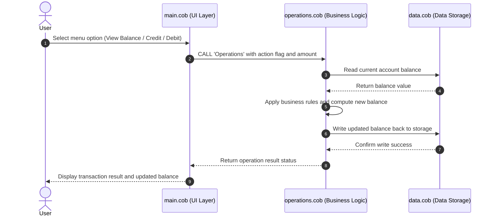

# Legacy COBOL Accounting System - Code Documentation

## Overview

This document provides a high-level overview of the school's legacy COBOL accounting system, explaining the purpose of each file and how they are linked together.

## File Descriptions

### 1. `main.cob` - Main Entry Point & User Interface

- **Role**: Serves as the primary entry point for the COBOL accounting application.
- **Responsibilities**:
  - Displays the main menu with options: View Balance, Credit Account, Debit Account, and Exit.
  - Accepts user input via `ACCEPT` statements.
  - Uses an `EVALUATE` statement to dispatch to the correct sub-program based on user selection.
  - Calls `operations.cob` using `CALL 'Operations'` with the appropriate action flag and amount.
- **Links to**: `operations.cob` (via CALL statement)

### 2. `operations.cob` - Business Logic Layer

- **Role**: Contains the core business logic for all account operations.
- **Responsibilities**:
  - Receives action requests from `main.cob` (actions such as `TOTAL`, `CREDIT`, or `DEBIT`).
  - Validates transactions and applies the appropriate arithmetic operations to account balances.
  - Reads from and writes to `data.cob` to fetch and persist modified state.
  - Returns results back to `main.cob` for display to the user.
- **Links to**: `main.cob` (called by), `data.cob` (calls for data access)

### 3. `data.cob` - Data Storage & State Management

- **Role**: Acts as the data persistence and state management layer.
- **Responsibilities**:
  - Defines the core data structures and variables holding account balance records.
  - Handles reading and updating the balance in storage across operations.
  - Maintains state across multiple operation calls within a session.
- **Links to**: `operations.cob` (called by)

## How the Files Are Linked

The three files form a classic three-tier layered architecture:

```
main.cob  →  (CALL)  →  operations.cob  →  (CALL)  →  data.cob
  (UI)                   (Business Logic)              (Data Layer)
```

## Data Flow Diagram



## Key Business Logic Summary

- **View Balance (TOTAL)**: Reads the current balance from `data.cob` and returns it to `main.cob` for display.
- **Credit Account (CREDIT)**: Adds the specified amount to the current balance in `data.cob`.
- **Debit Account (DEBIT)**: Subtracts the specified amount from the current balance in `data.cob`.
- **Exit**: Terminates the program loop in `main.cob`.
